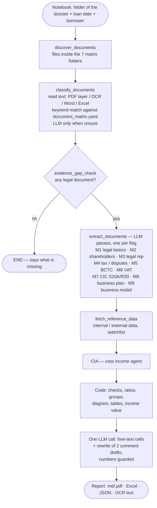
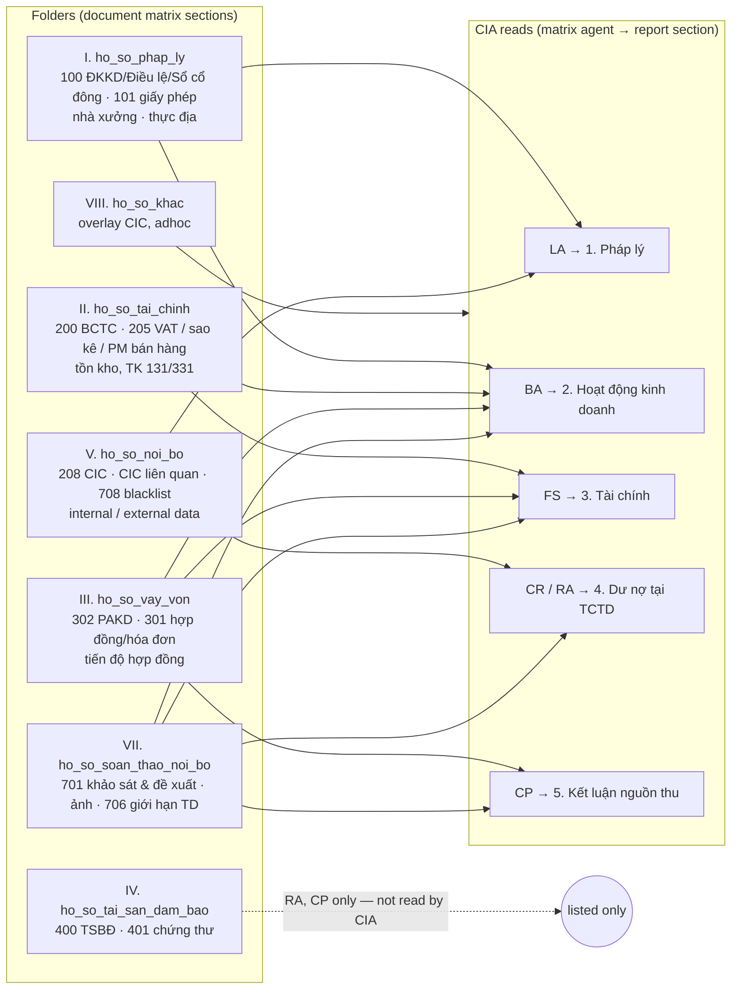

# Corp Income — Thẩm định nguồn thu doanh nghiệp

A **LangGraph** pipeline that reads a corporate (KHDN) dossier and writes the BRD's
**"Appendix - Corp income"** report — *Thẩm định nguồn thu doanh nghiệp* — for a retail borrower
whose repayment source is a company they own or hold capital in.

It follows the **BRD of 27/10/2026** and its **document matrix** (`BRD_documentmatrix`): the
dossier is sorted into the matrix's folders, each document type is tagged with the matrix agents
that use it, and this repo runs the **Corp Income Agent (CIA)**.

The entry point is the notebook [local_underwriting_agents.ipynb](local_underwriting_agents.ipynb);
all logic lives in [src/](src/). What changed from the previous BRD: [docs/CHANGES-BRD-2710.md](docs/CHANGES-BRD-2710.md).

---

## Table of Contents

- [How it works in one paragraph](#how-it-works-in-one-paragraph)
- [Workflow](#workflow)
- [Folders and document matrix](#folders-and-document-matrix)
- [The report (output template)](#the-report-output-template)
- [Who computes what](#who-computes-what)
- [Project structure](#project-structure)
- [Installation](#installation)
- [Configuration (.env)](#configuration-env)
- [Running it](#running-it)
- [Outputs](#outputs)
- [Tests](#tests)
- [Known limits and open points](#known-limits-and-open-points)

---

## How it works in one paragraph

Files are put in the folder of their document-matrix section. Each file is read once (PDF text
layer, OCR, Word, Excel), classified by keywords (an LLM only breaks ties), and every LLM
extraction pass the matrix flags for its type turns it into JSON. **Code** then does every check,
number, ratio, threshold and group of the BRD and fills the template; **one LLM call** writes only
the free-text cells (products, addresses, business-activity comment, conclusion) and is shown
every code result so it cannot contradict them.

---

## Workflow

### Pipeline (LangGraph, deterministic — no LLM decides the next step)



### From folder to report section



---

## Folders and document matrix

The matrix is [src/agents/documents/document_matrix.yaml](src/agents/documents/document_matrix.yaml) —
the single source of truth. Each type carries its matrix **code**, its **matrix_agents**
(CIA, LA, BA, FS, RA, CP, CR), the matrix **validation** rules (shown as a checklist in the Excel
"Hồ sơ" sheet), keywords, and which extraction passes run on it. CIA reads a type exactly when
the matrix lists CIA for it (the loader refuses a matrix where the two disagree).

| Folder | Matrix | What goes in |
|---|---|---|
| `ho_so_phap_ly` | I | **100** ĐKKD / GCN ĐKDN / GCN ĐT, điều lệ, sổ cổ đông / sổ thành viên, chuyển nhượng vốn · **101** giấy phép ngành nghề có điều kiện · hồ sơ quyền sử dụng nhà xưởng (HĐ thuê, GCN QSDĐ) · báo cáo khảo sát thực địa · QĐ bổ nhiệm, xử phạt, thanh tra, tranh chấp |
| `ho_so_tai_chinh` | II | **200** BCTC 2 năm, thuyết minh · **205** tờ khai VAT (thay thế: sao kê TK 6 tháng, phần mềm bán hàng 12 tháng) · chi tiết tồn kho / phải thu (TK 131) / phải trả (TK 331) · thông báo nợ thuế, BHXH |
| `ho_so_vay_von` | III | **302** phương án kinh doanh / đề nghị cấp tín dụng · **301** hợp đồng, hóa đơn đầu vào – đầu ra · hồ sơ tiến độ thực hiện hợp đồng |
| `ho_so_tai_san_dam_bao` | IV | **400** hồ sơ TSBĐ · **401** chứng thư định giá (RA, CP — not read by CIA) |
| `ho_so_noi_bo` | V | **208** CIC doanh nghiệp (S10A, R20) · CIC ĐDPL / cổ đông ≥ 30% · **708** blacklist / fraud · external data (tracuunnt, masothue, bocaodientu) · internal data (T24, BCDE, BEP, DBX, VIRAC) |
| `ho_so_soan_thao_noi_bo` | VII | **701** báo cáo khảo sát và đề xuất tín dụng, ảnh khảo sát · **706** báo cáo giới hạn tín dụng |
| `ho_so_khac` | VIII | overlay CIC, báo cáo adhoc, hồ sơ ngoài danh mục (read as context) |

Step-by-step for the people filing the dossier (Vietnamese): [docs/HUONG-DAN-XEP-HO-SO.md](docs/HUONG-DAN-XEP-HO-SO.md).

---

## The report (output template)

[src/templates/corp-income-structure.md](src/templates/corp-income-structure.md) writes out every
table of the BRD's **Appendix - Corp income** sheet — headers, columns and row labels are in the
file itself; code only fills cells and data rows:

| Section | Tables in the template |
|---|---|
| Header | Tên doanh nghiệp |
| **1. Pháp lý doanh nghiệp** | a. ID T24 · MST · năm thành lập ("Đăng ký lần đầu … thay đổi lần thứ …") · NĐDPL · tình trạng hoạt động (bold red when not operating) |
| | b. **Họ và tên \| Mối quan hệ \| Tỷ lệ góp vốn \| Thay đổi TV góp vốn & NĐDPL trong 12 tháng** — one row per member (`{{RowsThanhVien}}`) · Nhận xét về pháp lý Khách hàng |
| **2. Hoạt động kinh doanh** | Sản phẩm/dịch vụ · Địa chỉ TSC / nhà xưởng / kho · **Mô hình HĐKD**: sản phẩm đầu vào → ≤ 5 nhà cung cấp → doanh nghiệp → ≤ 5 khách mua → sản phẩm đầu ra · Nhận xét về HĐKD |
| **3. Tài chính** | Nguồn · **Bảng cân đối kế toán \| N-2 \| N-1 \| Báo cáo KQKD \| N-2 \| N-1 \| Cập nhật các tháng năm N** (triệu đồng) with the three ratios · Nhận xét · **Phân nhóm tài chính (POC) \| Phân loại \| Tiêu chí \| Kết quả** |
| **4. Dư nợ tại TCTD** | a. Ngày tra cứu CIC · b. **TCTD \| Số dư cấp tín dụng [Dư nợ ngắn hạn \| Dư nợ TDH \| Dư nợ khác \| Tổng số dư CTD] \| Tên TSBĐ \| Giá trị TSBĐ \| Chủ sở hữu TSBĐ** — one row per TCTD + total (`{{RowsDuNoTCTD}}`) · c. nợ cần chú ý, nợ xấu · **Phân nhóm bureau (POC)** |
| **5. Kết luận nguồn thu DN** | **Phương án kinh doanh (nếu có) \| N-2 \| N-1 \| Cập nhật năm T \| Năm kế hoạch \| Cơ sở của Khách hàng** × Doanh thu thuần / Biến động DTT / LNST / ROS · **Phân nhóm doanh nghiệp (POC)** · Nhận xét về nguồn thu + giá trị nguồn thu theo công thức BRD |

"Hiển thị khi …" rules, applied after filling (`appendix_context.apply_output_conditions`): the
business-plan table is removed when there is no plan; its "Cơ sở của Khách hàng" column when the
plan states no basis; the three "Phân nhóm (POC)" tables when `CORP_INCOME_SHOW_GROUPS=0`. In a
POC table the group that applies is marked ✔ in "Kết quả", with its basis.

Edit the template to change the layout — no Python change, as long as the `{{placeholders}}` stay.

---

## Who computes what

| Rule (BRD 27/10) | Done by | Where |
|---|---|---|
| Field priority ĐKKD → Điều lệ / Sổ cổ đông → thực địa; mismatches; status; 12-month changes; borrower %, NĐDPL | code | `calculator/legal_checks.py`, `utils/report/appendix_context.py` |
| Mô hình HĐKD: source priority, top 5 by value, suppliers left / buyers right, no invented rows, share only when given | code (LLM pass M9 only reads each document) | `calculator/business_model.py` |
| Ngành theo bảng ngành TCB, ROS ngành, tăng trưởng ngành | LLM picks one name from the list (M9); code looks it up | `calculator/industry.py`, `src/templates/bang-nganh-tcb.csv` |
| Nguyên tắc 1 (TT200 / TT133), 2 (tờ khai VAT), 3 (biến động DT, ROS, HSTT); dấu hiệu bất thường BCTC; trạng thái tài chính; Bad / Normal / Good finance | code | `calculator/financial_metrics.py` |
| CIC ≤ 1 tháng; bảng theo TCTD; nợ cần chú ý / nợ xấu; Bad / Normal / Good bureau (incl. chậm thanh toán thẻ 3 năm) | code | `calculator/cic_metrics.py` |
| Bad / Normal / Good corp | code | `appendix_context.corp_group` |
| Giá trị nguồn thu: LNST hợp lý, or projection with PAKD (min[PAKD; DT × (1 + tăng trưởng ngành × 1,5 if Good corp)], ROS = min{PAKD; max[lịch sử; ngành]}); LNST trả nợ TDH; lợi tức tối đa cho KHCN | code | `financial_metrics.income_estimate` |
| Sản phẩm/dịch vụ, địa chỉ, nhận xét HĐKD, kết luận (wording) | LLM, framed by `corp-income-cell-specs.md` | `agents/report_writer.py` |
| Nhận xét pháp lý, nhận xét tài chính | code draft, rewritten by the LLM; a rewrite that drops a number is rejected | `agents/specialist.py` (`POLISH_CELLS`) |

---

## Project structure

```
.
├── local_underwriting_agents.ipynb   # Entry point — driver notebook
├── config/prompts/                   # Every LLM prompt, one Markdown file each
├── src/
│   ├── config.py                     # build_llm (+ LLM_PROVIDER) and Config
│   ├── prompts.py                    # The only reader of config/prompts/
│   ├── types.py
│   ├── agents/
│   │   ├── supervisor.py             # LangGraph + EXTRACTION_PASSES (M1–M9)
│   │   ├── specialist.py             # CIA: records → checks → template → one LLM call
│   │   ├── report_writer.py          # The LLM call for the free-text cells
│   │   ├── documents/                # discovery, classification, document_matrix.yaml/.py
│   │   ├── extraction/               # one module per pass (LLM → JSON)
│   │   └── calculator/               # legal_checks, financial_metrics, cic_metrics,
│   │                                 # business_model, industry, borrowers
│   ├── templates/
│   │   ├── corp-income-structure.md  # The report layout (Appendix - Corp income)
│   │   ├── corp-income-guidance.md   # BRD guidance given to the LLM
│   │   ├── corp-income-cell-specs.md # Frame of each LLM-written cell
│   │   └── bang-nganh-tcb.csv        # PL1 — bảng ngành tại TCB (ROS, tăng trưởng)
│   └── utils/                        # reading (OCR, PDF, Word, Excel), report rendering, Excel export
├── samples/<testcase>/<folder>/      # The dossier, one sub-folder per matrix section (git-ignored)
├── logs/                             # Run outputs (git-ignored)
├── testing/                          # unittest, no API key needed
├── scripts/install_tesseract.sh      # Databricks cluster init script
└── docs/                             # changes, filing guide, technical notes, Databricks set-up
```

There are no `__init__.py` files under `src/`: it is a namespace package imported from the
project root as `src.agents.supervisor`.

---

## Installation

Python 3.11+ and **Tesseract OCR** with Vietnamese:

```bash
brew install tesseract tesseract-lang                     # macOS
sudo apt-get install tesseract-ocr tesseract-ocr-vie      # Ubuntu / Databricks (scripts/install_tesseract.sh)
pip install -r requirements.txt
```

PDF export needs WeasyPrint's native libraries; without them the notebook still saves the
`.md`, `.xlsx` and JSON files. Databricks: [docs/DATABRICKS.md](docs/DATABRICKS.md).

---

## Configuration (.env)

Copy `.env.example` → `.env` (on Databricks set the same names from `dbutils.secrets`):

```env
LLM_PROVIDER=openai          # openai | anthropic | databricks
MODEL_DOCUMENT=gpt-4o-mini   # classification tie-break
MODEL_ECONOMY=gpt-4o-mini    # cheaper passes
MODEL_PREMIUM=gpt-4o         # legal passes, BCTC, report writer
OPENAI_API_KEY=…   ANTHROPIC_API_KEY=…   DATABRICKS_HOST=…  DATABRICKS_TOKEN=…
CORP_INCOME_SHOW_GROUPS=1    # 0 hides the "Phân nhóm … (POC)" cells
```

The VAT, CIC, plan and business-model passes use `financial_extraction_llm` unless the notebook
sets their own LLM. An unset model or key raises at start-up, naming the variable.

---

## Running it

1. Put the dossier in `samples/<testcase>/` with one sub-folder per matrix section (table above).
2. Open the notebook. **Cell 4** — inputs:
   ```python
   TESTCASE_ID = "case_1"
   LOAN_PROGRAM = "KHDN"
   AGENT = "CORP_INCOME_AGENT"          # CIA
   INPUT_PATHS = [str(PROJECT_ROOT / "samples" / TESTCASE_ID)]
   LOAN_DATE = "27/10/2026"             # 12-month / 1-month checks end here; None = today
   BORROWER_NAMES = []                  # [] = found in ho_so_vay_von; fill in to override
   ANNUAL_LT_PRINCIPAL = None           # nghĩa vụ trả gốc TDH hằng năm của DN (đồng), if known
   ```
3. Run the cells in order: config → imports → `supervisor.process(...)` → save.

---

## Outputs

Written to `logs/<testcase>_<timestamp>/`:

| File | Content |
|---|---|
| `final_response.md` / `.pdf` | The report (Appendix layout) |
| `corp_income.xlsx` | Tóm tắt · 1–4 legal sheets · 5. Tài chính · **Mô hình HĐKD** · Kiểm tra · **Hồ sơ** (file, folder, matrix code, matrix agents, matrix validation checklist) |
| `corp_income.json` | Checks, financials, CIC, groups, income estimate, business model, every extraction record |
| `<pass>_extraction.json` | Each pass's JSON per document (incl. `business_model_extraction.json`) |
| `document_classifications.json` | Type, folder, source and read method per document |
| `ocr/<file>.txt` | The text read from each file — check here first when a value is wrong |

---

## Tests

```bash
python -m unittest testing.test_prompts testing.test_config testing.test_document_classification \
    testing.test_reading testing.test_corp_income_workflow testing.test_brd_1610 testing.test_brd_2710
```

`test_brd_2710` has one test per rule of the BRD / document matrix of 27/10/2026;
`test_corp_income_workflow` runs the whole graph with fake extraction chains (no API key).

---

## Known limits and open points

- **Bảng ngành TCB (PL1)**: only the first 13 rows (Recom) reached the repo — paste the rest into
  `src/templates/bang-nganh-tcb.csv`. Without the customer's industry in the table, the projection
  falls back to historical LNST and says so.
- No web search (masothue, bocaodientu, dangkykinhdoanh): save the lookup page into
  `ho_so_noi_bo`, or pass it as `EXTERNAL_DATA`.
- Photo content (products, machines, people) is not analysed — only text OCR reads from a photo.
- The matrix validation rules (đủ dấu, đủ trang, chữ ký…) are listed for the user to confirm in the
  Excel "Hồ sơ" sheet; only the date rules (CIC ≤ 1 tháng) are checked in code.
- Customer files and outputs are git-ignored — keep them in a Volume.
